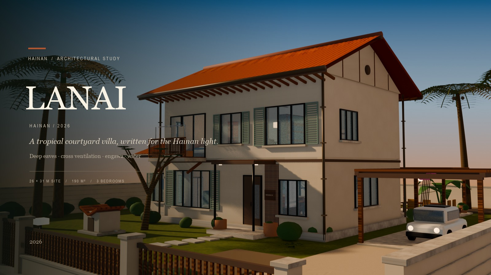

<h1 align="center">LANAI</h1>
<h3 align="center">HAINAN · 2026</h3>

<p align="center"><em>A tropical courtyard villa, written for the Hainan light.</em></p>

<p align="center">
  <a href="https://bougiezoe.github.io/lanai-house/"><strong>▶ OPEN LANAI LIVE →</strong></a><br>
  <sub>Desktop and phone · no install · WebGL2</sub>
</p>

<p align="center">
  <code>Blender 5.2</code> &nbsp;·&nbsp; <code>glTF 2.0</code> &nbsp;·&nbsp; <code>three.js r181</code> &nbsp;·&nbsp; <code>2026</code>
</p>

---

## The film

[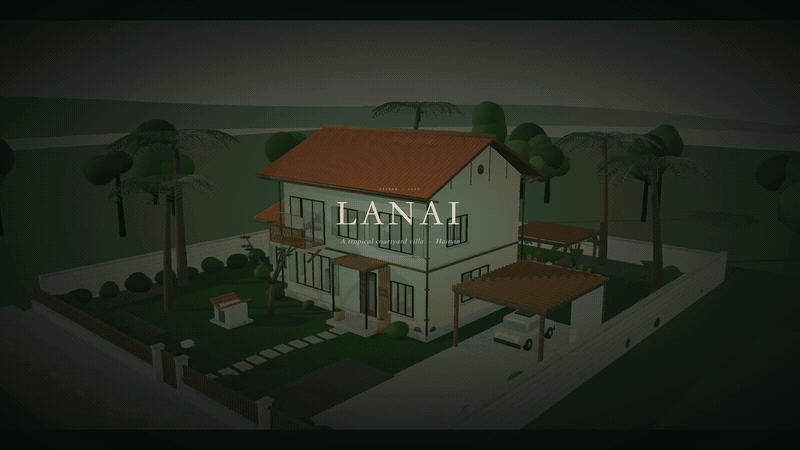](media/lanai-house.mp4)

**▶ [Watch the full 46-second film in 2K](media/lanai-house.mp4)** &nbsp;·&nbsp; `2560 × 1440` &nbsp;·&nbsp; no voiceover

The loop above is a 10-second preview; the full film moves from morning to noon, dusk and night, then through the house: exterior 360°, entrance, LDK, stair, pool, master bedroom and study.

*If the loop does not autoplay in your reader, open the [poster](renders/lanai-poster.jpg) or the [MP4](media/lanai-house.mp4) directly.*

<details>
<summary>Film chapters</summary>

| Time | Chapter |
|---|---|
| 00:00 | Title / first light |
| 00:04 | Exterior 360° |
| 00:17 | Approach |
| 00:19 | Entrance and genkan |
| 00:21 | Living / dining / kitchen |
| 00:24 | Dining detail |
| 00:26 | Stair |
| 00:29 | Pool and engawa |
| 00:35 | Master bedroom |
| 00:37 | Study |
| 00:39 | Dusk |
| 00:42 | Night |
| 00:44 | End card |

</details>

---

## The model

[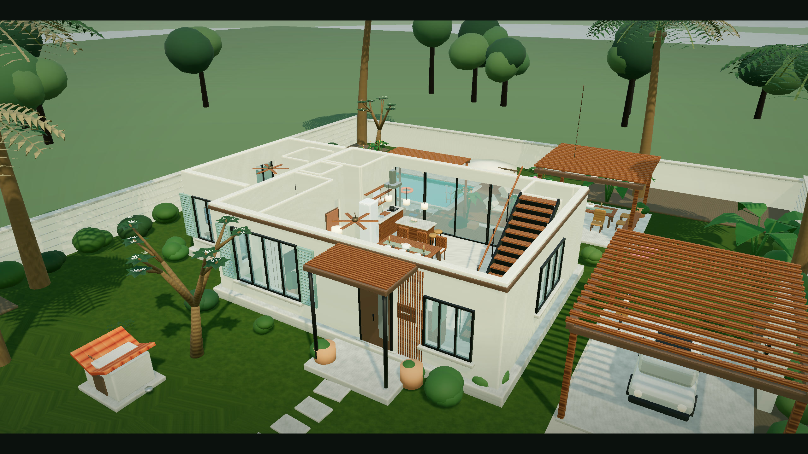](public/models/lanai_house.glb)

**[Download the GLB →](public/models/lanai_house.glb)** &nbsp;·&nbsp; `1.9 MB` &nbsp;·&nbsp; 10 merged meshes

The GLB is the same model used in the viewer, Draco-compressed, with WebP textures, at 1.9 MB. Open it in Blender, or drag it into [glTF Viewer](https://gltf-viewer.donmccurdy.com/). The pool water is kept as a separate mesh so it can animate; everything else is merged for real-time performance.

---

## A house that breathes

**LANAI** is a two-storey villa on a walled 26 × 31 m site in Hainan. It begins with the domestic warmth of a compact family house — the front yard, the laundry pole, the doghouse, the room that opens to the garden — and translates it into a tropical architecture of deep eaves, cross ventilation, shaded decks and water.

The name comes from the Hawaiian **lānai** — a roofed veranda, the room between inside and garden. It is the kind of room this house is built around: shaded, open, a little in between.

> A house is remembered less for its living room than for the unscheduled time under its eaves.

---

## The project

| | |
|---|---|
| **Site** | 26 × 31 m, walled tropical garden |
| **Gross floor area** | approx. 190 m² over two levels |
| **Footprint** | 10.4 × 8.0 m main house + 3.4 × 6.0 m west wing |
| **Programme** | 3 bedrooms + study/guest, 2.5 bathrooms, LDK, tea room, engawa |
| **Roof** | 24° pitch, Hainan red clay tile, 1.1 m eaves |
| **Pool** | 5.6 × 3.6 m, 1.45 m deep |
| **Climate** | hot-humid tropical; cross ventilation, shade and evaporative cooling |

---

## The plan

| Ground floor | Upper floor |
|---|---|
| 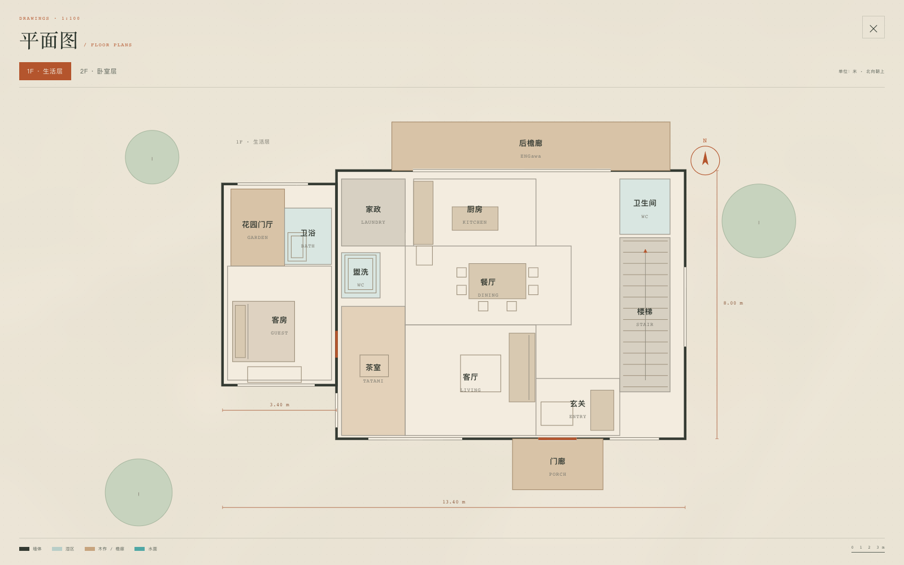 | 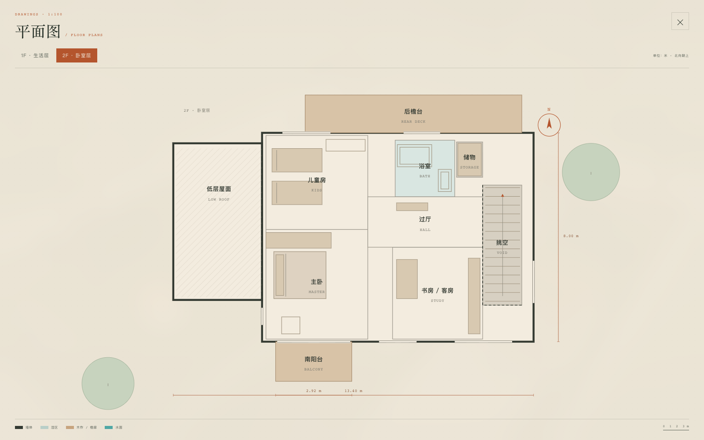 |

The plan is a sequence of thresholds rather than a corridor with rooms attached.

From the street, a shallow porch leads into a **genkan**. A low bench and the stair turn the route; beyond it, the **living room** holds the southern light. The **dining table** sits at the centre of the house; the **kitchen** runs along the west wall and opens north to the **engawa**. A low **tea room** and a **guest suite** occupy the west wing. The stair is a thin steel and teak ribbon on the east side, with a clear landing in front of the first tread.

Upstairs, the **master bedroom** takes the south-west corner and its balcony; the **kids' room** and **study/guest room** face the trees; the **bathroom** is a compact wet room. The stair void is left open so the house can be read in section.

> The best rooms are not the largest ones. They are the ones that know where the breeze comes from.

---

## Why it works

### 1. Deep eaves, low sun
The roof overhangs by **1.1 m**. It blocks the high midday sun, protects the lime-plaster walls and keeps the rain off the timber decks. Inside, the light is soft and indirect; at dusk the eaves frame the garden like a deep literary margin.

### 2. A plan that can be opened
The house is organised around a **north–south pressure path**. Air enters from the south windows and doors, crosses the LDK, and leaves through high north windows and the engawa. The north sliding doors can disappear completely, turning the dining room into a shaded outdoor room.

### 3. The engawa as climate infrastructure
The **13 m² rear engawa** is both a room and a machine: a deep shaded deck, a tea bench, a rain chain, a place to leave wet towels and sandy feet. It is the piece of the house that makes the tropical climate feel like an asset rather than a problem.

### 4. A west screen, not a west wall
Teak louvers, deep reveals and climbing plants filter the afternoon sun. The west facade is allowed to be textured and alive, instead of being sealed against the heat.

### 5. Water as a microclimate
The pool is placed tight to the engawa. Evaporation cools the immediate garden; the water reflects the roof and the sky back into the living spaces. It is a small piece of landscape doing structural work.

### 6. Wind with a pause — a feng shui note
Cross ventilation is genuinely good for a hot-humid climate: it lowers indoor humidity, reduces mould and keeps rooms comfortable without air-conditioning. In feng shui, however, a straight front-door-to-back-door draft is the classic **穿堂** condition — fast, unstable, and not a place to sit. The entry turn and the adjustable north sliding doors slow the air; at night the house can close down to a gentle cross-breeze. Fresh air, not a wind tunnel.

<sub>This is a design interpretation, not a feng shui consultation.</sub>

---

## Inside

| Living / dining | Master bedroom |
|---|---|
| 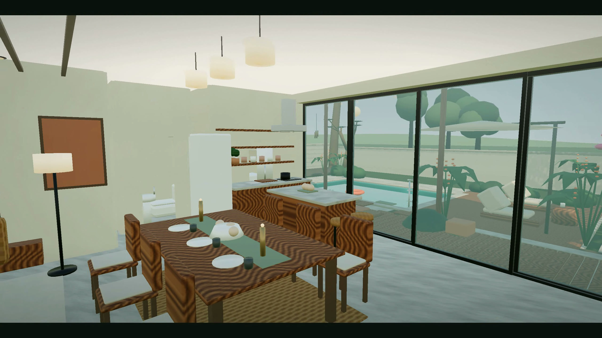 | 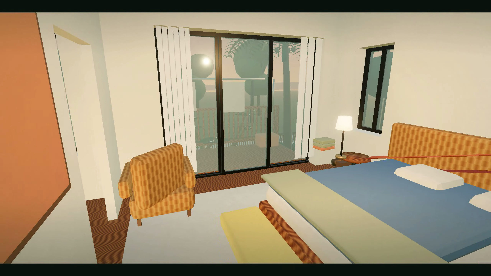 |

The interior is deliberately quiet: **lime plaster, teak, rattan, linen, basalt, sage and a single thread of terracotta**. Colour is carried by textiles and ceramics, not by painted walls. The result is a house that feels warm in the evening and cool at noon.

Furniture is placed by logic, not by symmetry:

- The **sofa** faces the TV wall but sits in the southern light; the coffee table holds books, a bowl and a candle, not a decorative arrangement.
- The **dining table** is centred under three paper pendants, with a linen runner, fruit, candles and chairs pulled slightly out.
- The **kitchen** follows a tight work triangle: sink, cooktop, island. The island faces the dining room so cooking is part of the conversation.
- The **master bed** faces the balcony; a slatted teak panel, bedside lamps and a folded throw make the room feel inhabited.
- The **kids' room** has two low beds, a pinboard, toys and a desk under the north light.
- The **study** is a desk, a daybed, a wall of books and a lamp that stays on too late.
- The **stair** is pulled clear of the shoe cabinet and umbrella stand, with a proper landing at the bottom.

### Details that make it a home

- Teak ceiling slats and recessed downlights over the LDK
- Linen curtains at the south windows and master balcony
- A slatted teak panel behind the master bed
- Paper lantern in the tea room; ceramics, tea set and a single branch
- Linen runner, fruit bowl, candles and chair cushions in the dining room
- A slim extractor, cutting board, kettle and herb pots in the kitchen
- Slippers, umbrella stand and a key tray at the genkan
- Towels, a bath stool and a plant in the bathroom
- Cushions, a tea tray and a brass wind chime on the engawa
- Towels and a tray by the pool

---

## Materials

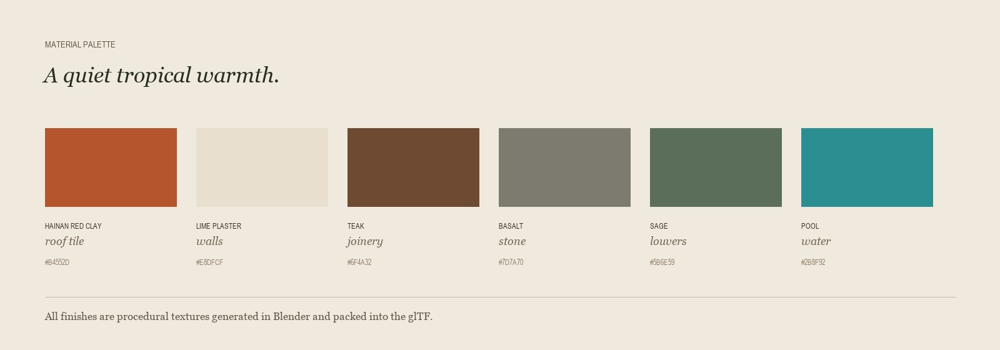

| Material | Where it is used |
|---|---|
| **Hainan red clay tile** | pitched roof, warm from a distance, textured up close |
| **Lime plaster** | walls; breathable, softly reflective, never flat white |
| **Teak** | structure, shutters, furniture, stair, engawa |
| **Basalt** | pool coping, bathroom, garden steps |
| **Sage green** | louvers, joinery accents, textiles |
| **Linen** | curtains, upholstery, bed linen, table runner |
| **Rattan** | chairs, lamps, headboards, outdoor furniture |
| **Terracotta** | pots, ceramics, the one saturated accent |

All textures are procedural, generated in Blender and packed into the glTF. No external 3D assets or image libraries are used.

---

## At dusk, at night

| Dusk | Night |
|---|---|
| 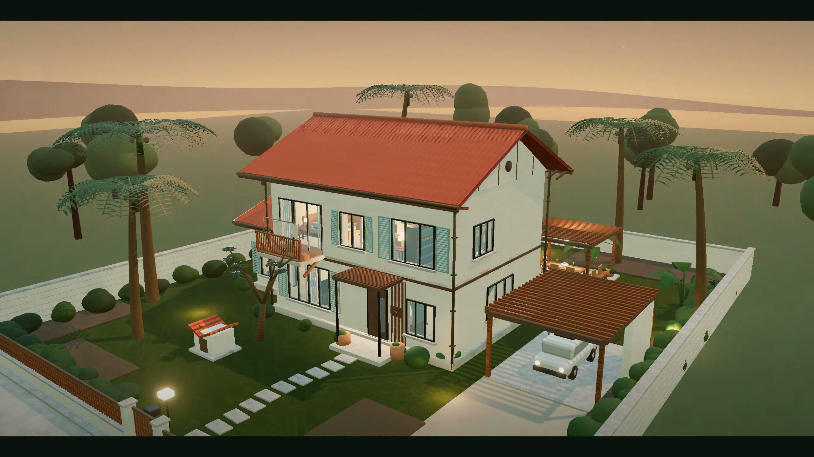 | 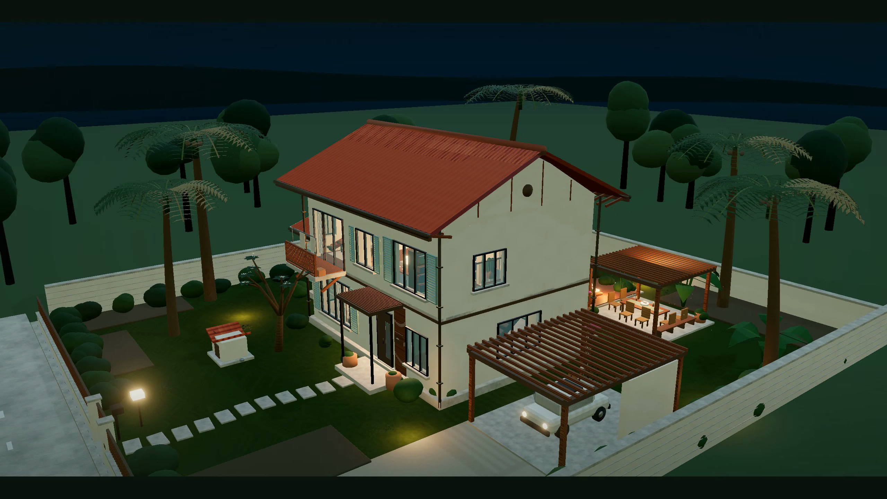 |
| **The stair, clear** | **Pool and engawa** |
| 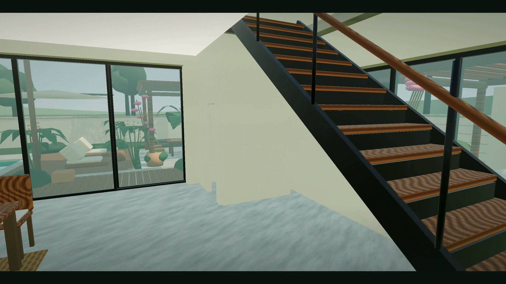 | 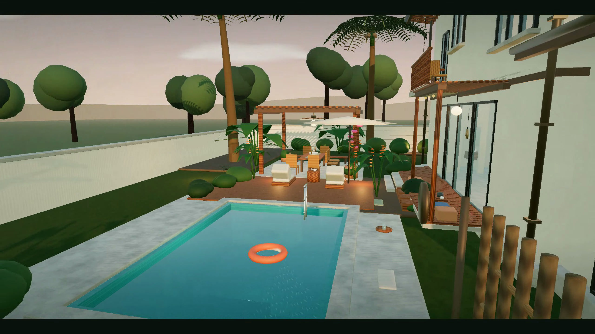 |

The same house, read in three lights. The stair is a clear object in the hall — no furniture in its footprint. At dusk the interiors warm up; at night the pool becomes a cyan lantern in the garden.

---

## Climate strategy

| Strategy | Effect |
|---|---|
| **1.1 m eaves** | blocks midday sun, protects walls, keeps rain off the deck |
| **Cross ventilation** | south inlet, north outlet; the LDK becomes a breeze path |
| **Engawa buffer** | shaded semi-outdoor room between garden and interior |
| **West screens** | teak louvers and vines filter the afternoon heat |
| **Pool + planting** | evaporative cooling and a cooler ground surface |
| **Rain chain** | roof water is led visibly to a stone basin |
| **Light materials** | lime plaster and pale stone reduce heat gain |

---

## Explore the house

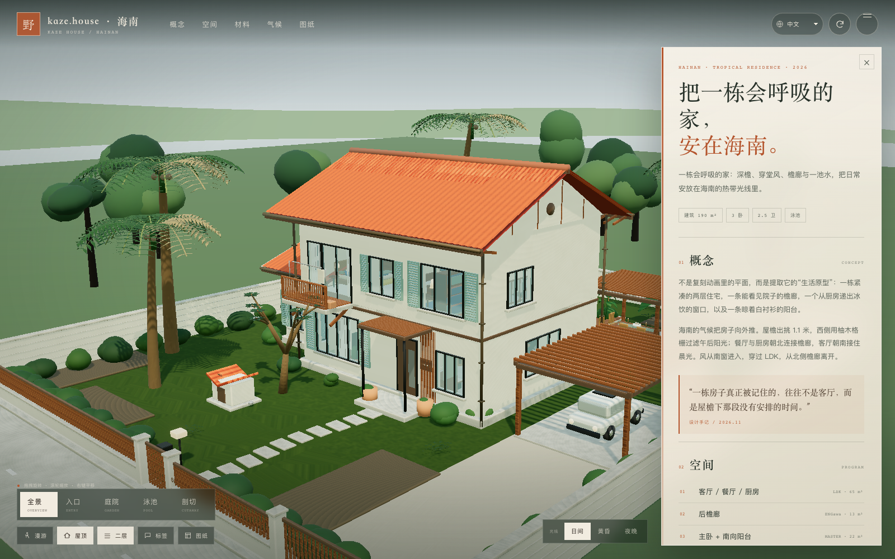

The viewer includes:

**[Open the live house →](https://bougiezoe.github.io/lanai-house/)** · works on desktop and phone

The live build uses GitHub Pages (free static hosting), a Draco + WebP GLB, and a DPR cap of 1.5 on touch devices / 2 on desktop. Nothing is installed; the model streams and the loading bar shows progress.

- Five camera views: **overview, entry, garden, pool, cutaway**
- **Day / dusk / night** lighting
- Roof, upper floor and room labels independently switchable
- Clickable room list with design notes
- **Free roam**: first-person walking, mouse look, stairs, floor switching and mobile joystick
- **Eight languages**: 中文 · English · 日本語 · 한국어 · Français · Deutsch · Español · Italiano
- 1F / 2F floor plans with localised room labels

### Free roam controls

| Input | Action |
|---|---|
| `W A S D` / arrow keys | walk |
| mouse | look (click to capture) |
| `Shift` | run |
| `E` near stair | change floor |
| `1` / `2` | jump to ground / upper floor |
| `L` | cycle language |
| `Esc` | exit |

On touch devices: left joystick to move, drag the right side to look.

---

## Technical notes

```text
blender/
  build_villa.py          procedural scene builder (saves .blend)
  villa_config.py         dimensions, levels, site, palette
  villa_geometry.py       geometry, UVs, material primitives
  villa_materials.py      procedural material library
  villa_architecture.py   walls, openings, roof, balconies
  villa_interior.py       partitions, joinery, furniture
  villa_details.py        curtains, lamps, styling, lived-in details
  villa_outdoor.py        engawa, pavilion, outdoor furniture
  villa_landscape.py      site, pool, walls, carport, planting
  lanai_house.blend

src/
  main.js                 viewer, camera, interaction, film mode
  environment.js          sky, sun, time-of-day
  i18n.js                 all copy in eight languages
  panel.js                localised design panel
  roam.js                 first-person controller and collision
  plan.js                 generated 1F / 2F plans

public/models/            lanai_house.glb (1.9 MB, 10 merged meshes)
media/                    lanai-house.mp4 (46 seconds, 2560 × 1440)
renders/                  stills, cover, palette, README loop
```

The Blender scene contains 2,000+ objects. For the web, they are joined into ten named groups — shell, interiors, roof, site, pool, landscape — which preserves the roof/floor toggles and the animated pool water while keeping draw calls low.

The film and stills are captured from the real-time three.js scene; the cover image is a Blender EEVEE still.

---

## Run it

```bash
npm install
npm run dev
# open http://127.0.0.1:4178
```

Production build:

```bash
npm run build
npm run preview
```

Requires Node.js 20.19+ (or 22.12+). WebGL2 and a current Chrome, Edge or Safari are recommended. The GLB is loaded over HTTP; do not open `index.html` directly from disk.

Rebuild the model:

```bash
/Applications/Blender.app/Contents/MacOS/Blender -b --python blender/build_villa.py
/Applications/Blender.app/Contents/MacOS/Blender -b --python blender/export_glb.py
```

---

## Credits

Design, modelling, text and film: **LANAI study** · Hainan, 2026.

A fan-made architectural study, made with affection for the Nohara family home in *Crayon Shin-chan*. Not affiliated with the original animation. Drawings are concept drawings, not construction documents.
